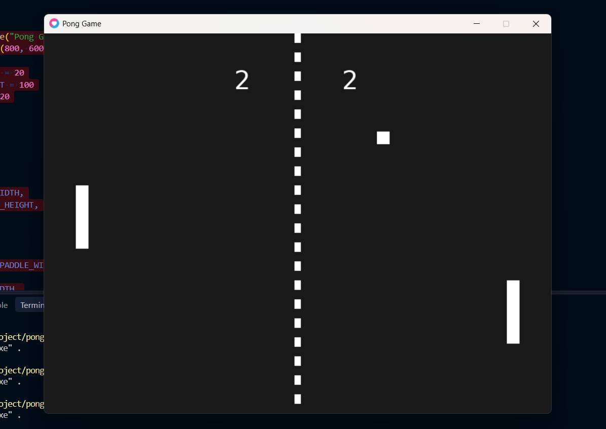

 Pong Game – LÖVE2D

 Student Information
- Name: raghad zagha
- Course: ai-gaming
- Assignment: Pong Game

 Project Description
This project is a two-player Pong game developed using Lua and the LÖVE2D framework.

The game includes two paddles, a bouncing ball, wall collisions, paddle collisions, and a scoring system.

## How to Run
1. Install [LÖVE2D](https://love2d.org/).
2. Download or clone this repository.
3. Open the project folder.
4. Run the following command in the terminal:

```bash
love .
```

 Controls

| Player | Controls |
|---|---|
| Player 1 | W – Move Up |
| Player 1 | S – Move Down |
| Player 2 | Up Arrow – Move Up |
| Player 2 | Down Arrow – Move Down |

 Game Features
- Two-player gameplay.
- Ball movement using horizontal and vertical velocity.
- Ball bounces off the top and bottom walls.
- Collision detection between the ball and both paddles.
- Ball direction changes after paddle collisions.
- Ball resets to the center after a player scores.
- Score tracking for both players.
- Paddles cannot move outside the game window.

 Extra Feature: Increasing Ball Speed

I added an extra feature that increases the ball's horizontal speed by 5% after each paddle collision.

This makes the game progressively faster and more challenging for both players.

 Screenshots



 Demo Video

[Watch the Pong Game Demo](demo.mp4)
